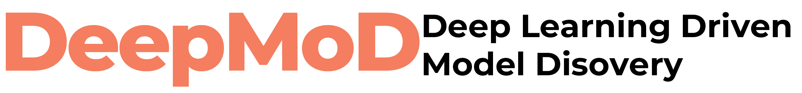
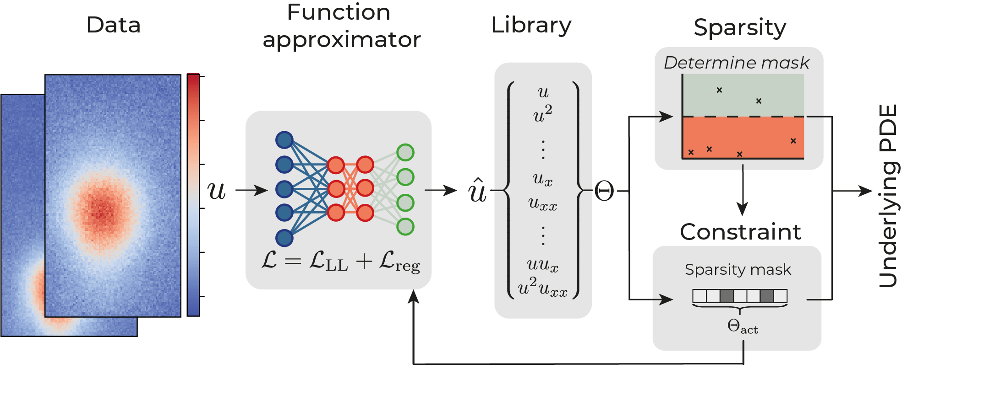

--------------------------------------------------------------------------------
 

DeePyMoD is a modular framework for model discovery of PDEs and ODEs from noise data. The framework is comprised of four components, that can separately be altered: i) A function approximator to construct a surrogate of the data, ii) a function to construct the library of features, iii) a sparse regression algorithm to select the active components from the feature library and iv) a constraint on the function approximator, based on the active components. 



More information can be found in the following two papers: , [arXiv:2011.04336](https://arxiv.org/abs/2011.04336), [arXiv:1904.09406](http://arxiv.org/abs/1904.09406) and the full documentation is available on [phimal.github.io/DeePyMoD/](https://phimal.github.io/DeePyMoD/).

**What's the use case?** Classical Model Discovery methods struggle with elevated noise levels and sparse datasets due the low accuracy of numerical differentiation. DeepMoD can handle high noise and sparse datasets, making it well suited for model discovery on actual experimental data.

**What types of models can you discover?** DeepMoD can discover non-linear, multi-dimensional and/or coupled ODEs and PDEs. See our paper and the examples folder for a demonstration of each.

# PDEComp benchmark compatibility

This fork includes a few compatibility fixes used by the PDEComp benchmark wrapper:

* `PDEFIND` creates PySINDy `STLSQ` objects through a small compatibility helper, so it works across PySINDy versions where the `fit_intercept` argument may or may not exist.
* Tensor normalization uses `reshape(...)` instead of `view(...)`, which avoids failures on non-contiguous PyTorch tensors.
* Sparse coefficient vectors and masks are normalized to stable one-dimensional shapes, including the single-term case.
* The training and logging code computes L1 norms per coefficient vector instead of assuming that all coefficient tensors can always be concatenated along the same dimension.
* Logging can run without TensorBoard installed; in that case a no-op `SummaryWriter` is used while model saving still works.

These changes do not alter the benchmark wrapper logic. They make the original DeePyMoD internals robust enough for fixed-library benchmark runs with different sparse estimators and small candidate sets.

# How to install

## Dependencies and CUDA
We support Python 3.6, 3.7 and 3.8.
We rely on the following packages, they will be installed in the pip installation procces for you:
``` numpy, torch, sklearn, pysindy, natsort, tensorboard, matplotlib```


We also make use of the PyTorch library, which can be installed with CPU and/or GPU support. Please
refer to the PyTorch ["Get Started"](https://pytorch.org/get-started/locally/) guide to get the version
that is optimal for your system. 

## Install 
To install DeePyMoD, pip can be used

``` pip install deepymod ```

in the main directory. 


## Development

If you wish to alter the code you can clone the package using:

``` git clone git@github.com:PhIMaL/DeePyMoD.git ```

and then install it from the cloned `DeePyMoD` directory using

``` pip install -e ./ ```

# Features

* **Many example notebooks** We have implemented a variety of examples ranging from 2D Advection Diffusion, Burgers' equation to non-linear, higher order ODE's If you miss any example, don't hesitate to give us a heads-up.

* **Extendable** DeePyMoD is designed to be easily extendable and modifiable. You can simply plug in your own cost function, library or training regime.

* **Automatic library** The library and coefficient vectors are automatically constructed from the maximum order of polynomial and differentiation. If that doesn't cut it for your use case, it's easy to plug in your own library function.

* **Extensive logging** We provide a simple command line logger to see how training is going and an extensive custom Tensorboard logger.

* **Fast** Depending on the size of the data-set DeepMoD, running a model search with DeepMoD takes of the order of minutes/ tens of minutes on a standard CPU. Running the code on GPU's drastically improves performance. 

